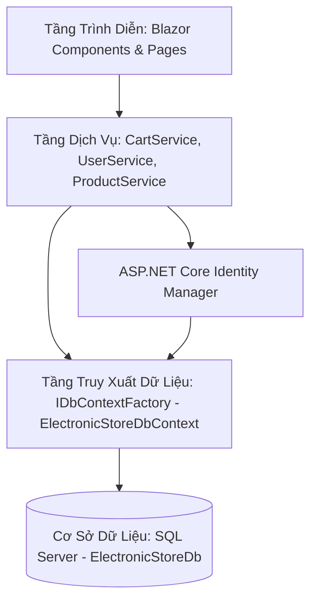
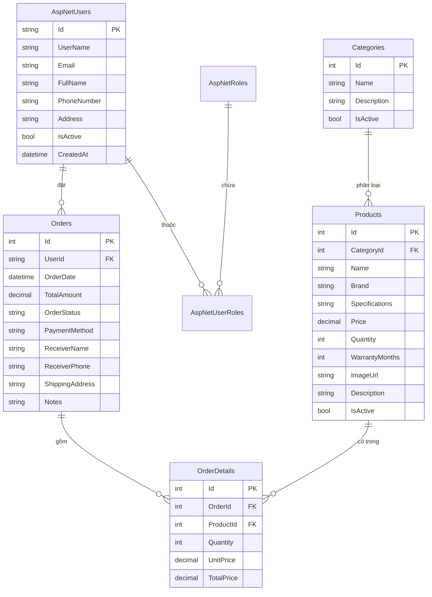
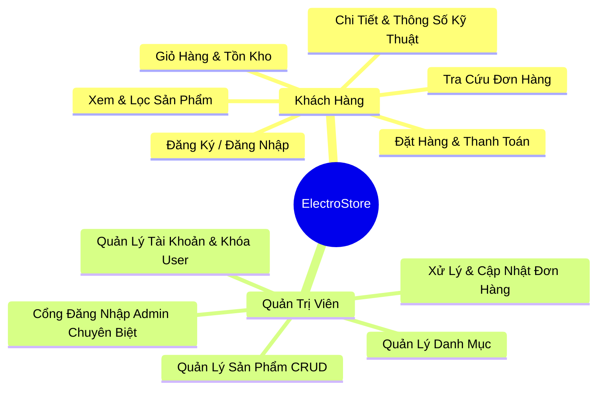

# TÀI LIỆU ĐẶC TẢ CHI TIẾT HỆ THỐNG (SYSTEM SPECIFICATION)
## DỰ ÁN: CỔNG THƯƠNG MẠI ĐIỆN TỬ THIẾT BỊ CÔNG NGHỆ (ELECTROSTORE BLAZOR)

---

## 1. TỔNG QUAN DỰ ÁN (PROJECT OVERVIEW)

### 1.1. Giới thiệu
**ElectroStore Blazor** là ứng dụng thương mại điện tử chuyên kinh doanh các thiết bị điện tử, công nghệ cao cấp (Điện thoại thông minh, Laptop đồ họa - gaming, Máy tính bảng, Thiết bị âm thanh, Đồng hồ thông minh và Phụ kiện). Hệ thống cung cấp trải nghiệm mua sắm trực tuyến liền mạch, phản hồi giao diện tức thì và phân hệ quản trị mạnh mẽ.

### 1.2. Mục tiêu hệ thống
* Cung cấp trải nghiệm mua sắm mượt mà với Single Page Application (SPA) trên nền tảng **Blazor Server**.
* Hệ thống phân quyền chặt chẽ giữa Khách hàng (Customer) và Quản trị viên (Admin).
* Quản lý kho hàng, thông số kỹ thuật thiết bị, đơn đặt hàng và tài khoản người dùng an toàn.
* Tối ưu hóa hiệu năng, an toàn đa luồng trên kết nối SignalR thời gian thực.

### 1.3. Công nghệ sử dụng
| Thành phần | Công nghệ / Thư viện | Phiên bản | Ghi chú |
| :--- | :--- | :--- | :--- |
| **Framework nền tảng** | .NET (C#) | .NET 10.0 | Công nghệ Web mới nhất của Microsoft |
| **Giao diện & Logic UI** | Blazor Server | InteractiveServer | Render tương tác real-time qua SignalR |
| **Xác thực & Phân quyền** | ASP.NET Core Identity | 10.0.12 | Quản lý User, Role, Password Hashing |
| **ORM / Truy xuất dữ liệu** | Entity Framework Core | 10.0.12 | Code-First / DbContextFactory |
| **Cơ sở dữ liệu** | Microsoft SQL Server | 2019 / 2022 / Express | Lưu trữ dữ liệu quan hệ |
| **UI Framework & Styling** | Bootstrap 5 + Vanilla Custom CSS | 5.3 + Custom CSS | Glassmorphism, Modern Dark/Light Accent |

---

## 2. KIẾN TRÚC HỆ THỐNG & CẤU TRÚC THƯ MỤC

### 2.1. Kiến trúc phân tầng (Layered Architecture)
Hệ thống được thiết kế theo kiến trúc phân tầng rõ ràng, giảm thiểu phụ thuộc lẫn nhau:



### 2.2. Giải pháp kỹ thuật đặc thù trong Blazor Server
1. **Quản lý DbContext an toàn đa luồng (`IDbContextFactory`)**:
   * Blazor Server duy trì một mạch kết nối SignalR duy nhất (Circuit) cho mỗi người dùng. Nếu sử dụng `DbContext` dạng Scoped thông thường, các thao tác đồng thời sẽ gây ra lỗi xung đột `InvalidOperationException: A second operation was started on this context instance before a previous operation completed`.
   * **Giải pháp**: Ứng dụng tiêm `IDbContextFactory<ElectronicStoreDbContext>`, tạo instance `using var context = _contextFactory.CreateDbContext()` trên từng phương thức để đảm bảo cô lập hoàn toàn.
2. **Quản lý trạng thái ứng dụng (State Management)**:
   * `CartService` và `UserService` được đăng ký dạng `Scoped`, kích hoạt `event Action? OnChange` để tự động render lại các component liên quan khi dữ liệu thay đổi (`NotifyStateChanged`).

### 2.3. Cấu trúc thư mục dự án
```text
ElectronicStore_blazor/
├── Components/
│   ├── App.razor                    # Root component cấu hình HTML shell, CSS, JS
│   ├── Routes.razor                 # Định tuyến ứng dụng với AppAssembly
│   ├── _Imports.razor               # Khai báo các using directive dùng chung
│   ├── Layout/                      # Layout tổng thể của hệ thống
│   │   ├── MainLayout.razor         # Layout chính cho khách hàng (Header, Nav, Footer)
│   │   ├── AdminLayout.razor        # Layout phân hệ quản trị (Sidebar, Topbar)
│   │   ├── EmptyLayout.razor        # Layout đơn giản cho các trang độc lập
│   │   ├── NavMenu.razor            # Menu điều hướng
│   │   └── ReconnectModal.razor     # Xử lý mất kết nối SignalR
│   └── Pages/                       # Các trang màn hình chức năng
│       ├── Account/                 # Xác thực tài khoản khách hàng
│       │   ├── Login.razor          # Đăng nhập khách hàng
│       │   └── Register.razor       # Đăng ký tài khoản
│       ├── Admin/                   # Phân hệ Cổng Quản Trị
│       │   ├── AdminLogin.razor     # Đăng nhập Cổng Admin chuyên biệt
│       │   ├── Products.razor       # Quản lý danh sách, thêm, sửa, xóa sản phẩm
│       │   ├── Categories.razor     # Quản lý danh mục ngành hàng
│       │   ├── Orders.razor         # Duyệt đơn hàng và cập nhật trạng thái
│       │   └── Accounts.razor       # Quản lý danh sách tài khoản & khóa người dùng
│       ├── Home.razor               # Trang chủ sản phẩm, tìm kiếm, lọc
│       ├── ProductDetail.razor      # Trang xem chi tiết thiết bị & thông số kỹ thuật
│       ├── Cart.razor               # Trang quản lý giỏ hàng
│       ├── Checkout.razor           # Trang tiến hành thanh toán & tạo đơn
│       ├── OrderSuccess.razor       # Màn hình thông báo đặt hàng thành công
│       ├── MyOrders.razor           # Tra cứu lịch sử đơn hàng
│       └── NotFound.razor           # Trang xử lý lỗi 404
├── Data/
│   ├── ElectronicStoreDbContext.cs  # DbContext mở rộng từ IdentityDbContext
│   └── DbSeeder.cs                  # Khởi tạo Roles, tài khoản mẫu và sửa lỗi mã hóa UTF-8
├── Models/
│   ├── CartItem.cs                  # DTO phục vụ giỏ hàng trong session
│   └── Entities/                    # Các thực thể dữ liệu ánh xạ database
│       ├── ApplicationUser.cs       # Mở rộng IdentityUser
│       ├── Category.cs              # Danh mục sản phẩm
│       ├── Product.cs               # Sản phẩm thiết bị điện tử
│       ├── Order.cs                 # Đơn đặt hàng
│       └── OrderDetail.cs           # Chi tiết đơn đặt hàng
├── Services/
│   ├── IProductService.cs           # Giao diện dịch vụ nghiệp vụ chính
│   ├── ProductService.cs            # Hiện thực truy vấn dữ liệu SQL Server
│   ├── CartService.cs               # Dịch vụ giỏ hàng bộ nhớ Scoped
│   └── UserService.cs               # Dịch vụ trạng thái phiên đăng nhập
├── wwwroot/                         # Tài nguyên tĩnh (CSS, JS, Fonts, Images)
├── Program.cs                       # Khởi tạo dịch vụ và pipeline ứng dụng
└── appsettings.json                 # Cấu hình chuỗi kết nối Database
```

---

## 3. MÔ HÌNH DỮ LIỆU & CƠ SỞ DỮ LIỆU (DATABASE SCHEMA)

### 3.1. Sơ đồ thực thể quan hệ (ERD)



### 3.2. Đặc tả các bảng dữ liệu

#### 1. Bảng `AspNetUsers` (Kế thừa từ `ApplicationUser`)
* Quản lý toàn bộ tài khoản người dùng của cả khách hàng và quản trị viên (thay thế hoàn toàn bảng Accounts và Customers cũ).
* Các thuộc tính mở rộng:
  * `FullName` (nvarchar(100)): Họ và tên đầy đủ của người dùng.
  * `Address` (nvarchar(255)): Địa chỉ mặc định dùng cho giao hàng.
  * `IsActive` (bit, default: `true`): Trạng thái hoạt động (`false` = đã bị quản trị viên khóa).
  * `CreatedAt` (datetime, default: `getdate()`): Thời điểm tạo tài khoản.

#### 2. Bảng `Categories` (Danh mục ngành hàng)
* `Id` (int, PK, Identity): Mã định danh danh mục.
* `Name` (nvarchar(100), Not Null): Tên danh mục (ví dụ: Điện thoại, Laptop, Máy tính bảng, Âm thanh).
* `Description` (nvarchar(255)): Mô tả tóm tắt về nhóm ngành hàng.
* `IsActive` (bit, default: `true`): Trạng thái hiển thị trên hệ thống.

#### 3. Bảng `Products` (Thiết bị điện tử)
* `Id` (int, PK, Identity): Mã sản phẩm.
* `CategoryId` (int, FK trỏ tới `Categories.Id`): Danh mục sản phẩm.
* `Name` (nvarchar(200), Not Null): Tên thiết bị (ví dụ: iPhone 15 Pro Max, MacBook Pro M3).
* `Brand` (nvarchar(100), Not Null): Hãng sản xuất (Apple, Samsung, Sony, Dell, Asus...).
* `Specifications` (nvarchar(max)): Thông số kỹ thuật chi tiết (RAM, CPU, ROM, Màn hình...).
* `Price` (decimal(18,2), Not Null): Giá niêm yết bán lẻ (VNĐ).
* `Quantity` (int, Not Null): Số lượng tồn kho sẵn sàng bán.
* `WarrantyMonths` (int, default: 12): Thời gian bảo hành chính hãng tính bằng tháng.
* `ImageUrl` (nvarchar(500)): Đường dẫn URL ảnh đại diện thiết bị.
* `Description` (nvarchar(max)): Giới thiệu đặc điểm nổi bật của máy.
* `IsActive` (bit, default: `true`): Trạng thái kinh doanh (`false` = ngừng bán hoặc đã xóa mềm).

#### 4. Bảng `Orders` (Đơn đặt hàng)
* `Id` (int, PK, Identity): Mã đơn hàng.
* `UserId` (nvarchar(450), FK trỏ tới `AspNetUsers.Id`): Khách hàng đặt mua.
* `OrderDate` (datetime, default: `getdate()`): Thời gian khởi tạo đơn.
* `TotalAmount` (decimal(18,2), Not Null): Tổng giá trị thanh toán của đơn hàng.
* `OrderStatus` (nvarchar(50), default: `'Pending'`):
  * `Pending` (Chờ duyệt)
  * `Confirmed` (Đã duyệt)
  * `Shipping` (Đang giao hàng)
  * `Completed` (Đã hoàn thành)
  * `Cancelled` (Đã hủy)
* `PaymentMethod` (nvarchar(50), default: `'COD'`): Phương thức thanh toán (`COD`, `Bank Transfer`, `VNPAY`, `MOMO`).
* `ReceiverName` (nvarchar(100), Not Null): Tên người nhận hàng.
* `ReceiverPhone` (nvarchar(20), Not Null): Số điện thoại liên hệ giao hàng.
* `ShippingAddress` (nvarchar(255), Not Null): Địa chỉ giao nhận chi tiết.
* `Notes` (nvarchar(500)): Ghi chú của khách hàng khi đặt.

#### 5. Bảng `OrderDetails` (Chi tiết đơn hàng)
* `Id` (int, PK, Identity): Mã chi tiết dòng hàng.
* `OrderId` (int, FK trỏ tới `Orders.Id`): Đơn hàng cha.
* `ProductId` (int, FK trỏ tới `Products.Id`): Thiết bị được mua.
* `Quantity` (int, Not Null): Số lượng đặt mua.
* `UnitPrice` (decimal(18,2), Not Null): Giá tại thời điểm đặt.
* `TotalPrice` (decimal(18,2), Not Null): Thành tiền (`Quantity * UnitPrice`).

---

## 4. PHÂN HỆ VÀ ĐẶC TẢ CHỨC NĂNG CHI TIẾT



---

### 4.1. PHÂN HỆ KHÁCH HÀNG (CUSTOMER PORTAL)

#### Chức năng 1: Trang chủ & Tìm kiếm / Lọc sản phẩm (`Home.razor` - `/`)
* **Giao diện**:
  * Hero Showcase trình diễn sản phẩm công nghệ nổi bật.
  * Thanh tìm kiếm từ khóa đa năng: tìm theo Tên thiết bị, Thương hiệu, Thông số kỹ thuật (RAM, CPU, Dung lượng).
  * Bộ lọc nhanh Thương hiệu (Brand Pills): Apple, Samsung, Sony, Dell, Asus, HP, Xiaomi...
  * Thanh Tab Danh mục (Category Tabs): Chuyển đổi linh hoạt giữa Điện thoại, Laptop, Phụ kiện. Đồng bộ hai chiều với Query Parameter trên URL (`?category=X`).
  * Phân trang động (Pagination): Chia đều 8 sản phẩm trên mỗi trang, tự động tính toán tổng số trang theo kết quả lọc.
* **Tương tác**:
  * Nhấn vào thẻ sản phẩm chuyển sang trang chi tiết.
  * Nhấn nút "Thêm vào giỏ" thêm trực tiếp sản phẩm vào giỏ hàng và hiển thị Toast thông báo tương tác (tự biến mất sau 3 giây).

#### Chức năng 2: Chi tiết thiết bị & Thông số kỹ thuật (`ProductDetail.razor` - `/product-detail/{id}`)
* **Giao diện**:
  * Breadcrumb điều hướng phân cấp (Trang chủ > Danh mục > Tên sản phẩm).
  * Khung trình diễn ảnh sản phẩm phân giải cao kèm Huy hiệu bảo hành chính hãng và thương hiệu.
  * Bảng thông số kỹ thuật (Specifications) cấu hình chi tiết: Chipset, RAM, Ổ cứng lưu trữ, Kích thước màn hình, Dung lượng pin.
  * Tình trạng kho hàng: Hiển thị trạng thái "Còn hàng (X sản phẩm)" hoặc "Hết hàng".
* **Xử lý nghiệp vụ**:
  * Cho phép người dùng điều chỉnh số lượng muốn mua (tối đa không vượt quá số lượng tồn kho thực tế).
  * Nút "Thêm vào giỏ" và "Mua ngay" (điều hướng thẳng vào trang Giỏ hàng / Thanh toán).

#### Chức năng 3: Quản lý giỏ hàng (`Cart.razor` - `/cart`)
* **Giao diện**:
  * Danh sách thiết bị trong giỏ: Ảnh minh họa, Tên, Hãng, Đơn giá, Bộ điều khiển tăng giảm số lượng, Thành tiền.
  * Khung tổng kết đơn giá: Tạm tính, Phí vận chuyển (Miễn phí toàn quốc), Tổng thanh toán.
  * Nút "Xóa tất cả giỏ hàng" và nút "Tiến hành thanh toán".
* **Xử lý nghiệp vụ**:
  * Tự động giới hạn số lượng tối đa bằng đúng lượng tồn kho hiện tại.
  * Cảnh báo người dùng nếu sản phẩm đã hết hàng trong kho.
  * Cập nhật tức thời thông số tổng tiền và badge số lượng trên thanh Header.

#### Chức năng 4: Thanh toán & Đặt hàng (`Checkout.razor` - `/checkout`)
* **Yêu cầu bắt buộc**: Khách hàng **bắt buộc phải đăng nhập** tài khoản thành viên để thực hiện mua hàng (nhằm quản lý hồ sơ bảo hành điện tử và đối soát thông tin đơn hàng). Nếu chưa đăng nhập, hệ thống hiển thị form hướng dẫn đăng nhập / đăng ký kèm đường dẫn quay lại.
* **Quy trình đặt hàng**:
  1. Tự động điền trước Họ tên, Số điện thoại, Địa chỉ từ hồ sơ `ApplicationUser`.
  2. Người dùng chọn phương thức thanh toán:
     * Thanh toán khi nhận hàng (COD).
     * Chuyển khoản ngân hàng qua mã QR.
     * Cổng thanh toán trực tuyến (VNPAY / MOMO).
  3. Nhập ghi chú giao nhận (nếu có).
  4. Hệ thống thực hiện kiểm tra an toàn (Double-check) tồn kho từng sản phẩm trong database:
     * Nếu kho không đủ: Báo lỗi chi tiết tên sản phẩm và số lượng thiếu.
     * Nếu hợp lệ: Tạo bản ghi `Order`, các dòng `OrderDetail`, tự động trừ số lượng tồn kho `Product.Quantity` tương ứng, xóa trắng giỏ hàng và chuyển hướng sang trang `OrderSuccess.razor`.

#### Chức năng 5: Tra cứu lịch sử đơn hàng (`MyOrders.razor` - `/my-orders`)
* **Trường hợp đã đăng nhập**: Hiển thị danh sách toàn bộ các đơn hàng đã đặt theo tài khoản hiện tại, sắp xếp theo thời gian mới nhất.
* **Trường hợp chưa đăng nhập**: Cung cấp ô nhập Số điện thoại nhận hàng để tra cứu nhanh các đơn đã đặt.
* **Thông tin hiển thị trên từng đơn**:
  * Mã đơn hàng (#ORD-X), Ngày đặt, Tổng tiền.
  * Badge trạng thái trực quan với màu sắc tương ứng (Chờ duyệt - Vàng, Đã duyệt - Xanh dương, Đang giao - Tím, Hoàn thành - Xanh lá, Đã hủy - Đỏ).
  * Danh sách các sản phẩm và số lượng thuộc đơn hàng.
  * Địa chỉ nhận hàng và phương thức thanh toán đã chọn.

#### Chức năng 6: Đăng nhập & Đăng ký khách hàng (`Account/Login.razor`, `Account/Register.razor`)
* **Đăng ký**: Kiểm tra hợp lệ Tên đăng nhập, Email, Mật khẩu (tối thiểu 6 ký tự), Họ tên, Địa chỉ. Tự động gán quyền `Customer`.
* **Đăng nhập**: Kiểm tra tên người dùng và mật khẩu bằng `UserManager.CheckPasswordAsync`. Kiểm tra cờ `IsActive` (nếu tài khoản bị Admin khóa sẽ chặn đăng nhập kèm thông báo).
* **Tiện ích**: Nút "Điền nhanh" tài khoản mẫu (`nguyenvana / 123456`) phục vụ kiểm thử và chấm điểm đồ án nhanh chóng.

---

### 4.2. PHÂN HỆ QUẢN TRỊ (ADMIN PORTAL)

Toàn bộ phân hệ quản trị sử dụng giao diện chuyên biệt `AdminLayout.razor` với menu sidebar cố định, kiểm tra thẩm quyền vai trò Admin trên từng thao tác.

#### Chức năng 1: Cổng đăng nhập quản trị (`Admin/AdminLogin.razor` - `/admin/login`)
* Cổng đăng nhập tách biệt với khách hàng thông thường.
* **Quy tắc bảo mật**: Chỉ cho phép các tài khoản thuộc Role `Admin` truy cập. Nếu tài khoản khách hàng thông thường (`Customer`) đăng nhập tại đây, hệ thống từ chối truy cập và thông báo không đủ thẩm quyền.
* Cung cấp nút điền nhanh tài khoản Admin mặc định (`admin / admin123`).

#### Chức năng 2: Quản lý sản phẩm (`Admin/Products.razor` - `/admin/products`)
* **Hiển thị**: Bảng dữ liệu chi tiết gồm Mã, Hình ảnh thu nhỏ, Tên thiết bị, Danh mục, Thương hiệu, Đơn giá, Tồn kho, Thời hạn bảo hành, Trạng thái hoạt động.
* **Tìm kiếm & Lọc**: Tìm kiếm theo tên sản phẩm hoặc hãng; Lọc theo danh mục.
* **Thêm mới sản phẩm (Modal)**: Form nhập liệu đầy đủ trường (Tên, Danh mục, Hãng, Đơn giá, Tồn kho, Bảo hành, URL hình ảnh, Mô tả, Thông số kỹ thuật).
* **Cập nhật sản phẩm**: Tải dữ liệu sản phẩm lên Modal để chỉnh sửa và lưu vào SQL Server.
* **Bật/Tắt trạng thái (Toggle Active)**: Ẩn/Hiện sản phẩm trên trang khách hàng chỉ với một cú nhấp.
* **Xóa sản phẩm an toàn**:
  * Nếu sản phẩm đã phát sinh trong đơn hàng (`OrderDetails` có bản ghi): Tự động chuyển thành **Xóa mềm (Soft Delete)** bằng cách gán `IsActive = false` để đảm bảo toàn vẹn dữ liệu lịch sử đơn hàng.
  * Nếu sản phẩm chưa có đơn hàng: Xóa cứng khỏi cơ sở dữ liệu.

#### Chức năng 3: Quản lý danh mục ngành hàng (`Admin/Categories.razor` - `/admin/categories`)
* **Giao diện 2 cột hiện đại**:
  * Cột trái: Form thêm mới hoặc cập nhật nhanh danh mục (Tên danh mục, Mô tả).
  * Cột phải: Bảng danh sách tất cả các danh mục kèm đếm số lượng sản phẩm đang có trong danh mục đó.
* **Quy tắc ràng buộc toàn vẹn dữ liệu**: Không cho phép xóa danh mục nếu đang có sản phẩm thuộc danh mục đó. Hệ thống thông báo rõ số lượng sản phẩm liên kết cần chuyển đổi trước khi xóa.

#### Chức năng 4: Quản lý & Duyệt đơn hàng (`Admin/Orders.razor` - `/admin/orders`)
* **Thanh lọc trạng thái (Filter Chips)**: Cho phép lọc đơn theo từng trạng thái: *Tất cả*, *Chờ duyệt (Pending)*, *Đã duyệt (Confirmed)*, *Đang giao (Shipping)*, *Hoàn thành (Completed)*, *Đã hủy (Cancelled)*.
* **Thao tác chuyển trạng thái tức thì**:
  * Nút "Duyệt đơn": Chuyển từ Chờ duyệt sang Đã duyệt.
  * Nút "Giao hàng": Chuyển từ Đã duyệt sang Đang giao.
  * Nút "Hoàn tất": Chuyển sang Hoàn thành.
  * Nút "Hủy đơn": Chuyển trạng thái sang Đã hủy.
* **Xem chi tiết đơn**: Mở modal xem danh sách thiết bị đặt mua, đơn giá thời điểm đặt, số điện thoại và địa chỉ giao hàng.

#### Chức năng 5: Quản lý tài khoản & Khóa người dùng (`Admin/Accounts.razor` - `/admin/accounts`)
* **Danh sách tài khoản**: Liệt kê toàn bộ người dùng trong hệ thống (Username, Vai trò Admin/Customer, Họ tên, SĐT, Email, Địa chỉ, Ngày tạo, Trạng thái hoạt động).
* **Chức năng Khóa / Mở khóa (Toggle Lock)**:
  * Quản trị viên có thể bấm "Khóa tài khoản" đối với các tài khoản vi phạm hoặc có dấu hiệu gian lận.
  * Người dùng bị khóa sẽ bị đăng xuất ngay lập tức và không thể đăng nhập lại vào hệ thống.
  * Khóa bảo vệ tài khoản quản trị chính: Không cho phép tự khóa chính tài khoản Admin đang đăng nhập.

---

## 5. CÁC QUY TẮC NGHIỆP VỤ & BẢO MẬT (BUSINESS RULES)

### 5.1. Quy tắc kiểm soát tồn kho (Anti-Overselling)
1. Không cho phép thêm vào giỏ hàng số lượng lớn hơn lượng hàng tồn thực tế (`Product.Quantity`).
2. Khi người dùng bấm đặt hàng tại trang Checkout, hệ thống kích hoạt Transaction kiểm tra lại tồn kho trực tiếp từ Database. Nếu xảy ra tranh chấp (nhiều người cùng mua món đồ cuối cùng), đơn hàng đến sau sẽ bị từ chối và thông báo nguyên nhân rõ ràng.
3. Khi đơn hàng tạo thành công, số lượng tồn kho `Quantity` của sản phẩm tự động bị trừ đi tương ứng.

### 5.2. Quy tắc bảo mật & Quản lý phiên làm việc
1. Mật khẩu được băm (hashing) chuẩn PBKDF2 thông qua `IPasswordHasher<ApplicationUser>` của ASP.NET Core Identity.
2. Kiểm tra quyền hạn theo tầng:
   * Phân hệ Admin yêu cầu Role `Admin`.
   * Trang Checkout yêu cầu đăng nhập tài khoản hợp lệ.
3. An toàn dữ liệu với cơ chế Soft Delete: Các bản ghi quan trọng liên quan đến hóa đơn và doanh thu không bao giờ bị xóa vật lý nếu đã phát sinh quan hệ.

---

## 6. HƯỚNG DẪN CÀI ĐẶT & VẬN HÀNH (DEPLOYMENT & SETUP)

### 6.1. Yêu cầu môi trường
* **Hệ điều hành**: Windows 10/11, macOS, hoặc Linux.
* **SDK**: .NET SDK 10.0 (hoặc tương thích .NET 9.0+).
* **Database**: SQL Server 2019/2022 hoặc LocalDB / SQL Server Express.

### 6.2. Cấu hình chuỗi kết nối (Connection String)
Mở file `appsettings.json` trong thư mục `ElectronicStore_blazor/` và cấu hình:

```json
{
  "ConnectionStrings": {
    "DefaultConnection": "Server=(localdb)\\mssqllocaldb;Database=ElectronicStoreDb;Trusted_Connection=True;MultipleActiveResultSets=true;TrustServerCertificate=True"
  },
  "Logging": {
    "LogLevel": {
      "Default": "Information",
      "Microsoft.AspNetCore": "Warning"
    }
  },
  "AllowedHosts": "*"
}
```

### 6.3. Khởi tạo Cơ sở dữ liệu & Chạy ứng dụng
Thực hiện các lệnh sau tại thư mục `ElectronicStore_blazor`:

```powershell
# 1. Khôi phục các thư viện NuGet
dotnet restore

# 2. Khởi chạy ứng dụng (Hệ thống sẽ tự động tạo bảng, nạp tài khoản mẫu và sửa mã hóa tiếng Việt)
dotnet run
```

Sau khi chạy lệnh, truy cập trình duyệt tại địa chỉ hiển thị trên Terminal: `https://localhost:5001` hoặc `http://localhost:5000`.

### 6.4. Danh sách tài khoản thử nghiệm có sẵn trong hệ thống
| Vai trò (Role) | Tên đăng nhập (Username) | Mật khẩu (Password) | Quyền hạn |
| :--- | :--- | :--- | :--- |
| **Quản trị viên (Admin)** | `admin` | `admin123` | Toàn quyền quản trị hệ thống, duyệt đơn, thêm sửa sản phẩm, khóa tài khoản |
| **Khách hàng 1 (Customer)** | `nguyenvana` | `123456` | Mua hàng, xem lịch sử đơn, cập nhật thông tin nhận hàng |
| **Khách hàng 2 (Customer)** | `tranthib` | `123456` | Khách hàng thử nghiệm luồng mua hàng |

---

## 7. KẾT LUẬN & ĐÁNH GIÁ ĐỒ ÁN
Dự án **ElectronicStore_blazor** là một giải pháp hoàn chỉnh và hiện đại cho bài toán thương mại điện tử chuyên ngành thiết bị số:
* Áp dụng đầy đủ các tiêu chuẩn lập trình C# hiện đại (.NET 10, C# 13/14).
* Tận dụng tối đa sức mạnh của **Blazor Server** để tạo ra giao diện Single Page mượt mà, phản hồi ngay lập tức mà không cần viết các API Controller phức tạp.
* Thiết kế cơ sở dữ liệu chuẩn hóa, tích hợp chặt chẽ với ASP.NET Core Identity.
* Giao diện UI/UX trực quan, hiện đại, tối ưu cho cả máy tính và thiết bị di động.
